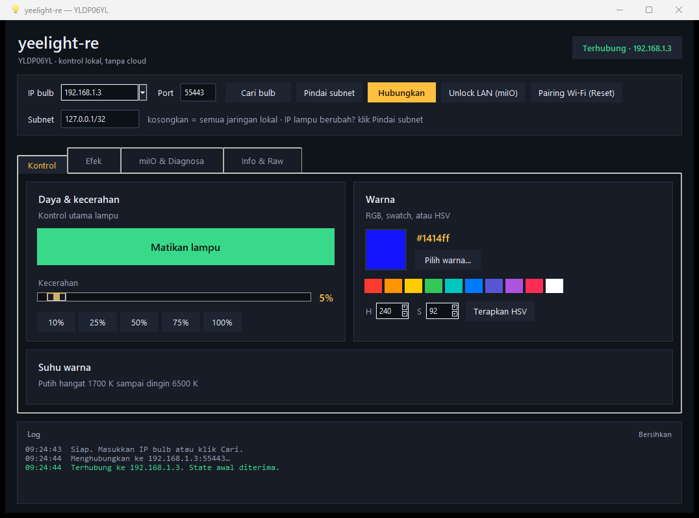

# yeelight-re

Toolkit reverse engineering dan kontrol **lokal 100% offline** untuk **Yeelight Smart LED Bulb (Color) Generasi 2 — model `YLDP06YL`** (dikenal di ekosistem smart home sebagai `color2`).

Tool ini **tidak pernah login** ke akun Yeelight, Mi Home, atau cloud mana pun. Semua komunikasi berjalan langsung di LAN Anda: discovery SSDP di UDP `1982`, kontrol JSON-RPC di TCP `55443`, dan protokol darurat miIO di UDP `54321`.

> [!NOTE]
> **Karakteristik Utama:**
> - **Zero-dependency**: Murni menggunakan pustaka bawaan Python (Python 3.9+). Bahkan modul AES-128-CBC ditulis murni tanpa `cryptography` / `pycryptodome`.
> - **Siap Pakai**: Tersedia versi aplikasi mandiri Windows (`.exe`) baik untuk Desktop GUI maupun CLI.
> - **Mandiri (No Cloud)**: Mendukung provisioning Wi-Fi tanpa aplikasi HP dan pembukaan port kontrol LAN secara lokal.

---

## Daftar Isi
- [Download & Langsung Pakai (Windows)](#download--langsung-pakai-windows)
- [Status Fitur](#status-fitur)
- [Panduan Penggunaan](#panduan-penggunaan)
  - [1. Desktop GUI (Paling Mudah)](#1-desktop-gui-paling-mudah)
  - [2. Command Line (CLI)](#2-command-line-cli)
  - [3. Pairing Lampu Baru / Ter-reset (Tanpa App HP)](#3-pairing-lampu-baru--ter-reset-tanpa-app-hp)
  - [4. Dashboard Web Lokal](#4-dashboard-web-lokal)
  - [5. Interactive REPL](#5-interactive-repl)
- [Penggunaan sebagai Library Python](#penggunaan-sebagai-library-python)
- [Emulator (Uji Tanpa Hardware)](#emulator-uji-tanpa-hardware)
- [Troubleshooting](#troubleshooting)
- [Struktur Repositori](#struktur-repositori)
- [Build Sendiri (PyInstaller)](#build-sendiri-pyinstaller)
- [Dokumentasi Lanjutan](#dokumentasi-lanjutan)

---

## Download & Langsung Pakai (Windows)

Build portabel siap pakai sudah tersedia di folder `dist\`:

| File | Keterangan |
|---|---|
| [`dist\yeelight-re-gui.exe`](dist/yeelight-re-gui.exe) | **Aplikasi GUI Desktop** (klik dua kali, bertema modern dark, tanpa konsol) |
| [`dist\yeelight-re.exe`](dist/yeelight-re.exe) | **CLI Tool** satu berkas (±6,5 MB, langsung jalan di CMD/PowerShell) |
| [`dist\yeelight-re-0.3.0-win64.zip`](dist/yeelight-re-0.3.0-win64.zip) | Paket zip lengkap berisi GUI, CLI, dan petunjuk pemakaian |

Executable ini **tidak membutuhkan instalasi Python, akun, atau koneksi internet**.

> [!TIP]
> Karena executable dibuat lokal dan belum ditandatangani sertifikat berbayar, Windows SmartScreen mungkin menampilkan peringatan saat pertama kali dijalankan. Klik **More info** → **Run anyway**.

---

## Status Fitur

| Bagian | Status | Deskripsi |
|---|:---:|---|
| **Desktop GUI** | ✅ Jalan | 4 tab: Kontrol, Efek, miIO & Diagnosa, Info & Raw (power, warna, CT, scene, flow, music, timer, raw) |
| **Timer Mati Otomatis** | ✅ Jalan | `set_scene ["auto_delay_off", bright, menit]` dari GUI (tab Efek) atau raw command |
| **Discovery SSDP** | ✅ Jalan | Deteksi multicast UDP 1982 (cepat, tapi bisa diblokir router) |
| **Pindai Subnet (IP dinamis)** | ✅ Jalan | Sapu TCP 55443 seluruh subnet, lalu kenali tiap lampu (nama/model/daya/kecerahan); otomatis dipakai GUI kalau IP tersimpan sudah tidak menjawab |
| **Kontrol Lokal Persisten** | ✅ Jalan | JSON-RPC di TCP 55443 dengan penanganan event asinkron |
| **Music Mode** | ✅ Jalan | Mode streaming low-latency via UDP (melewati kuota 60 cmd/menit) |
| **Provisioning Wi-Fi (Tanpa App)** | ✅ Jalan | Hubungkan lampu baru/ter-reset ke Wi-Fi rumah via miIO (`wifi-setup`) |
| **Unlock LAN Control (miIO)** | ✅ Jalan | Membuka TCP 55443 via `set_ps cfg_lan_ctrl=1` tanpa aplikasi resmi |
| **Local Web Dashboard** | ✅ Jalan | Dashboard browser mandiri di `http://127.0.0.1:8765/` |
| **Bulb In-Process Emulator** | ✅ Jalan | Mensimulasikan bulb lengkap untuk pengembangan tanpa lampu fisik |
| **Unit & Integration Tests** | ✅ Lulus | 47 skenario pengujian dengan cakupan AES, protocol, client, discovery (termasuk scan), miIO, dan CLI |

---

## Panduan Penggunaan

### 1. Desktop GUI (Paling Mudah)

Cukup klik dua kali [`dist\yeelight-re-gui.exe`](dist/yeelight-re-gui.exe).



```text
+------------------------------------------------------------------------+
|  yeelight-re                        YLDP06YL · kontrol lokal           |
|  tanpa cloud                                           [Terhubung]      |
+------------------------------------------------------------------------+
| IP bulb [192.168.1.8] Port [55443] [Cari bulb] [Pindai subnet]          |
|                        [Hubungkan] [Unlock LAN (miIO)] [Pairing Wi-Fi]  |
+------------------------------------------------------------------------+
| Subnet [192.168.1.0/24]  kosongkan = semua jaringan lokal              |
|                          IP berubah? klik Pindai subnet                 |
+------------------------------------------------------------------------+
| [ Kontrol ] [ Efek ] [ miIO & Diagnosa ] [ Info & Raw ]                 |
|                                                                         |
|  Kontrol          daya, kecerahan 1-100%, color picker, swatch,         |
|                   slider suhu warna, HSV, status langsung               |
|  Efek             9 scene, flow animasi, music mode, timer mati         |
|  miIO & Diagnosa  handshake miIO, unlock LAN Control, diagnosa lengkap  |
|  Info & Raw       IP/model/firmware/nama, ganti nama, raw command       |
+------------------------------------------------------------------------+
| Log aktivitas (timestamp + level, tombol Bersihkan)                     |
+------------------------------------------------------------------------+
```

**Yang bisa dilakukan dari GUI:**

| Tab | Fitur |
|---|---|
| **Kontrol** | Tombol daya, slider kecerahan, color picker, 10 swatch warna, slider CT 1700–6500 K, slider hue/saturation |
| **Efek** | 9 preset scene (Baca, Santai, Malam, Fokus, Film, Senja, Hutan, Laut, Lilin), flow animasi dengan jumlah loop, demo music mode (rainbow/pulse/white), timer mati otomatis |
| **miIO & Diagnosa** | Cek handshake miIO, unlock LAN Control, diagnosa jaringan lengkap, kolom token manual |
| **Info & Raw** | Detail perangkat dari SSDP + API LAN, ganti nama bulb, kirim raw JSON-RPC untuk reverse engineering |

1. Klik tombol **Cari bulb** untuk mendeteksi IP lampu secara otomatis, atau masukkan IP manual.
2. Klik **Hubungkan**.
3. Jika port kontrol lampu masih terkunci, GUI mendeteksi sendiri lalu menawarkan **unlock lewat miIO**. Setelah berhasil, GUI otomatis menghubungkan ulang.
4. Pengaturan IP/port/subnet terakhir disimpan di `%APPDATA%\yeelight-re\gui.json`.

#### IP lampu berubah-ubah (DHCP)? Pakai **Pindai subnet**

SSDP hanya bekerja kalau router meneruskan multicast. Untuk IP dinamis, tombol
**Pindai subnet** lebih ampuh: GUI menyapu seluruh subnet lewat TCP 55443, lalu
mengenali setiap host yang menjawab sebagai Yeelight (nama, model, daya,
kecerahan).

- **Satu lampu ditemukan** → IP diisi otomatis dan GUI langsung menghubungkan.
- **Beberapa lampu ditemukan** → semua IP masuk ke dropdown; pilih satu, klik Hubungkan.
- **Isi kolom Subnet** kalau jaringan Anda bukan `/24` standar (mis. `192.168.0.0/24`).
  Kosongkan untuk memindai semua antarmuka jaringan PC (`/24` masing-masing),
  jadi tetap ketemu walau Anda punya Wi-Fi + Ethernet + VPN sekaligus.
- **Saat GUI dibuka**, kalau IP tersimpan tidak menjawab, GUI otomatis memindai
  subnet dan menyambung ke lampu yang ditemukan. Jadi setelah lampu dapat IP baru,
  Anda cukup membuka aplikasi.
- Saat koneksi terputus di tengah pemakaian, log akan mengingatkan untuk klik
  **Pindai subnet**.

> [!TIP]
> Cara permanen: atur *DHCP Reservation* / *Static Lease* untuk MAC lampu di
> router, supaya IP-nya tidak berubah lagi. Fitur pindai tetap berguna untuk
> kasus pindah jaringan atau router di-reset.

GUI juga bisa dibuka dari CLI:

```powershell
yeelight-re gui --ip 192.168.1.8
python -m yeelight_re.gui --ip 192.168.1.8
```

> [!NOTE]
> Pada build `yeelight-re.exe`, Tkinter tidak disertakan agar berkasnya tetap kecil. Perintah `yeelight-re.exe gui` akan otomatis menjalankan `yeelight-re-gui.exe` yang ada di folder yang sama.

---

### 2. Command Line (CLI)

Semua perintah dapat dijalankan menggunakan executable `.\dist\yeelight-re.exe` atau lewat Python:

```powershell
# Jalankan dari source:
python -m yeelight_re [command]

# Atau install ke environment lokal:
pip install -e .
yeelight-re [command]
```

#### A. Menemukan Lampu (termasuk saat IP berubah)

```powershell
# Pencarian cepat via multicast SSDP (bisa gagal kalau router blokir multicast)
yeelight-re discover

# IP dinamis / SSDP tidak jawab: sapu subnet + kenali tiap lampu
yeelight-re scan
# Output:
#   Lampu Yeelight ditemukan: 1
#     192.168.1.3:55443 | tanpa nama | nyala | 100%
#     model color | power on | bright 100% | name (kosong)
#   Pakai: yeelight-re status --ip 192.168.1.3

# Tentukan subnet sendiri (kalau jaringan bukan /24 standar)
yeelight-re scan --subnet 192.168.1.0/24

# Output JSON untuk skrip / integrasi
yeelight-re scan --json

# SSDP + subnet scan sekaligus
yeelight-re discover --scan --subnet 192.168.1.0/24
```

`scan` memeriksa setiap host pada TCP 55443, lalu mengirim `get_prop` untuk
memastikan host itu benar-benar lampu Yeelight (bukan perangkat lain yang
kebetulan membuka port). Hasilnya: IP terbaru + nama + daya + kecerahan.

Tanpa `--subnet`, semua antarmuka jaringan PC dipindai (`/24` per antarmuka) —
penting untuk laptop yang punya Wi-Fi, Ethernet, dan VPN sekaligus, karena
rute default belum tentu jaringan tempat lampu berada. Jaringan CGNAT
(`100.64.0.0/10`, dipakai Tailscale) dilewati. Subnet lebih besar dari `/20`
ditolak agar pemindaian tetap cepat (biasanya 2–5 detik untuk beberapa `/24`).

#### B. Diagnosa Kondisi Jaringan & Lampu
```powershell
yeelight-re doctor --ip 192.168.1.8
```

#### C. Kontrol Dasar
```powershell
# Cek status
yeelight-re status --ip 192.168.1.8

# Power
yeelight-re on --ip 192.168.1.8
yeelight-re off --ip 192.168.1.8
yeelight-re toggle --ip 192.168.1.8

# Kecerahan (1-100%)
yeelight-re bright 60 --ip 192.168.1.8

# Warna RGB (#HEX, r,g,b, atau desimal)
yeelight-re color "#ff6600" --ip 192.168.1.8
yeelight-re color "0,200,255" --bright 80 --ip 192.168.1.8

# Suhu Warna Putih (1700 K - 6500 K)
yeelight-re ct 3200 --ip 192.168.1.8

# Hue & Saturation (HSV)
yeelight-re hsv 200 80 --ip 192.168.1.8
```

#### D. Preset Scene & Animasi (Flow)
```powershell
# Lihat daftar preset
yeelight-re scene --list
yeelight-re flow --list

# Terapkan scene
yeelight-re scene movie --ip 192.168.1.8

# Jalankan animasi flow
yeelight-re flow party --ip 192.168.1.8
yeelight-re flow candle --ip 192.168.1.8
```

---

### 3. Pairing Lampu Baru / Ter-reset (Tanpa App HP)

Jika saklar lampu dimatikan-nyalakan 5 kali berturut-turut, lampu akan ter-reset ke setelan pabrik dan memancarkan hotspot Wi-Fi sendiri (misalnya `yeelink-light-color2_miapXXXX`).

**Anda tidak perlu menginstal aplikasi resmi Yeelight / Mi Home di HP!**

1. Sambungkan Wi-Fi laptop/PC Anda ke hotspot lampu tersebut (`yeelink-light-...`).
2. Jalankan salah satu cara di bawah:

**Lewat GUI:**
- Buka `yeelight-re-gui.exe`.
- Klik tombol **`Pairing Wi-Fi (Reset)`**.
- Masukkan nama Wi-Fi rumah (2.4 GHz) dan password-nya.

**Lewat CLI:**
```powershell
yeelight-re wifi-setup --ssid "NamaWiFiRumah" --password "PasswordWiFi"
```

3. Lampu otomatis menerima konfigurasi, mengaktifkan fitur LAN Control, mematikan hotspotnya, dan bergabung ke router Wi-Fi rumah Anda.
4. Sambungkan kembali laptop Anda ke Wi-Fi rumah, lalu jalankan `yeelight-re scan`.

---

### 4. Dashboard Web Lokal

Buka kontrol lampu berbasis browser yang ringan tanpa internet:

```powershell
yeelight-re web --ip 192.168.1.8 --open
```

Akses melalui browser di `http://127.0.0.1:8765/`.

---

### 5. Interactive REPL

Untuk sesi kontrol cepat interaktif:

```powershell
yeelight-re repl --ip 192.168.1.8
```
```text
yeelight> on
yeelight> bright 80
yeelight> color #00e5ff
yeelight> ct 4000
yeelight> status
yeelight> quit
```

---

## Penggunaan sebagai Library Python

Pustaka ini dapat diintegrasikan langsung ke dalam skrip Python atau automasi Anda sendiri:

```python
from yeelight_re import YeelightClient, discover

# Temukan perangkat pertama di LAN
devices = discover()
if not devices:
    raise SystemExit("Lampu tidak ditemukan!")

bulb_ip = devices[0].ip

with YeelightClient(bulb_ip) as bulb:
    print("Status:", bulb.status())
    bulb.set_power(True)
    bulb.set_bright(75)
    bulb.set_rgb(0x00FF99)
```

Contoh lebih lengkap tersedia di [examples/control.py](examples/control.py).

**Mencari lampu saat IP-nya berubah (scan subnet):**

```python
from yeelight_re import YeelightClient, scan_lan

for hit in scan_lan():            # default: semua NIC lokal, /24 masing-masing
    if hit.is_bulb:
        print(hit.ip, hit.name or "(tanpa nama)", hit.power, f"{hit.bright}%")
        with YeelightClient(hit.ip) as bulb:
            bulb.set_power(True)

# Subnet tertentu + hanya IP-nya:
bulbs = [hit.ip for hit in scan_lan("192.168.1.0/24") if hit.is_bulb]
```

`scan_lan()` mengembalikan `BulbHit` (`ip`, `port`, `name`, `model`, `power`,
`bright`, `status`, `is_bulb`). Host yang membuka port tapi bukan Yeelight tetap
dikembalikan dengan `is_bulb=False`, berguna saat mendiagnosa firewall.

---

## Emulator (Uji Tanpa Hardware)

Anda dapat menguji seluruh fungsi tanpa memiliki lampu fisik:

**Jalankan Emulator di Terminal 1:**
```powershell
python -m yeelight_re.fake_bulb --port 55443 --ssdp --miio
```

**Jalankan Perintah di Terminal 2:**
```powershell
yeelight-re status --ip 127.0.0.1
yeelight-re color "#ff0055" --ip 127.0.0.1
yeelight-re gui --ip 127.0.0.1
```

---

## Troubleshooting

| Gejala | Kemungkinan Penyebab | Solusi |
|---|---|---|
| **IP lampu berubah / tidak bisa connect** | DHCP memberi alamat baru | Di GUI: klik **Pindai subnet** (atau cukup buka ulang GUI — pemindaian otomatis jalan kalau IP tersimpan mati). Di CLI: `yeelight-re scan`. Cara permanen: DHCP Reservation di router. |
| `TCP 55443: connection refused` | Lampu dalam mode hotspot (AP) atau LAN Control belum ON | Jika lampu memancarkan Wi-Fi `_miap`, lakukan [Pairing Wi-Fi](#3-pairing-lampu-baru--ter-reset-tanpa-app-hp). Jika sudah terhubung router, jalankan `yeelight-re miio --ip IP --enable`. |
| `timed out` saat koneksi | IP berubah karena DHCP atau beda subnet | Jalankan `yeelight-re scan` untuk menemukan IP terbaru lampu, atau atur *DHCP Reservation* di router. |
| SSDP tidak menemukan lampu | Router memblokir multicast UDP | Gunakan pindai subnet: `yeelight-re scan --subnet 192.168.1.0/24` atau `yeelight-re discover --scan`. |
| `scan` tidak menemukan apa pun | Lampu di subnet lain / LAN Control mati | Cek IP PC (`ipconfig`), lalu sesuaikan `--subnet`. `scan` hanya melihat host dengan TCP 55443 terbuka, jadi LAN Control harus aktif. |
| Perintah ditolak / lampu tidak merespons | Batas koneksi maksimal tercapai | Firmware Yeelight membatasi maksimal 4 koneksi TCP aktif simultan. Tutup instance GUI atau skrip yang menggantung. |
| SmartScreen memblokir `.exe` | Binary belum ditandatangani digital | Klik **More info** → **Run anyway**. Source code lengkap tersedia di repositori ini untuk diverifikasi. |

Detail arsitektur dan penanganan lebih mendalam tersedia di:
- [docs/TANPA-LOGIN.md](docs/TANPA-LOGIN.md) — Panduan bypass akun dan skenario pembebasan cloud.
- [docs/PROTOCOL.md](docs/PROTOCOL.md) — Rincian spesifikasi protokol LAN Yeelight & miIO.
- [docs/HARDWARE.md](docs/HARDWARE.md) — Panduan teardown, pinout UART, dump, dan firmware pihak ketiga.

---

## Struktur Repositori

```text
yeelight-re/
├── yeelight_re/             # Pustaka utama
│   ├── protocol.py          # Definisi protokol LAN & parser JSON-RPC
│   ├── client.py            # Client koneksi persistent TCP & music mode
│   ├── discovery.py         # SSDP discovery, port probe & subnet scanner (scan_lan)
│   ├── miio.py              # Protokol miIO (handshake, unlock, & wifi-setup)
│   ├── _aes.py              # Implementasi AES-128 murni Python (zero-dependency)
│   ├── fake_bulb.py         # Emulator lampu in-process
│   ├── presets.py           # Preset scene & animasi flow
│   ├── cli.py               # Antarmuka Command Line & REPL
│   ├── web.py               # Dashboard web lokal
│   └── gui.py               # Aplikasi Desktop GUI (Tkinter murni)
├── tests/                   # 47 skenario pengujian unit & integrasi
├── docs/                    # Dokumentasi riset mendalam
│   ├── PROTOCOL.md          # Spesifikasi teknis protokol
│   ├── TANPA-LOGIN.md       # Analisis bebas akun & cloud
│   └── HARDWARE.md          # Teardown, UART, & modifikasi hardware
├── packaging/               # Asset PyInstaller, icon, dan launcher
├── dist/                    # Executable siap pakai (.exe & .zip)
└── build_exe.ps1            # Skrip otomatisasi build Windows
```

---

## Build Sendiri (PyInstaller)

Jika ingin mem-build ulang berkas `.exe` dari source:

```powershell
powershell -ExecutionPolicy Bypass -File build_exe.ps1
```

Skrip ini akan secara otomatis:
1. Mempersiapkan virtual environment di `%TEMP%`.
2. Menghasilkan ikon aplikasi (`tools/make_icon.py`).
3. Mengompilasi `yeelight-re.exe` (CLI) dan `yeelight-re-gui.exe` (GUI).
4. Mengemas seluruh berkas ke dalam zip siap pakai di folder `dist\`.

---

## Lisensi & Disclaimer

- Berlisensi **MIT**.
- Proyek ini adalah proyek independen dan tidak berafiliasi dengan Yeelight atau Xiaomi. Reverse engineering dilakukan semata-mata untuk interoperabilitas dan kontrol perangkat pribadi secara lokal.